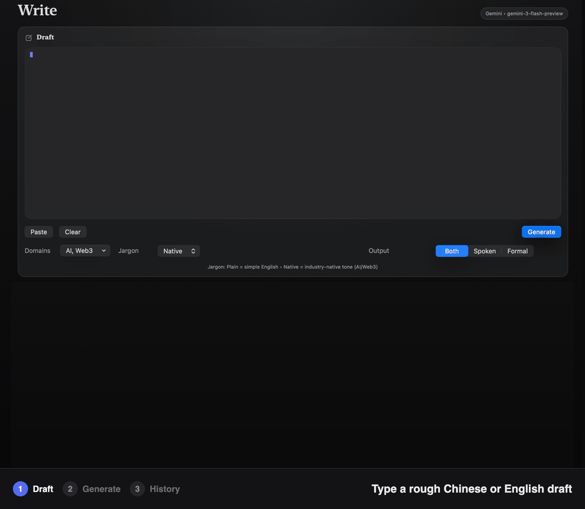

# Thought2English — turn Chinese or English notes into native English (macOS)

**English** · [中文](README.zh-CN.md)

**A macOS menu bar and window app that rewrites your rough Chinese or English notes into two polished English versions: a Spoken Script and Formal Writing, using your own Gemini or DeepSeek API key.** (The repo is named `englearn`; the app is called Thought2English.)



## Install

```bash
brew tap risingjerry/thought2english
brew install --cask thought2english
```

Upgrade with `brew upgrade --cask thought2english`. Or download the zip from [Releases](https://github.com/risingjerry/englearn/releases), or build it yourself (see below).

Then open **Settings**, choose a provider, and paste your API key.

## Highlights

- **Two outputs at once** — *Spoken Script* (how you would actually say it, with an industry-native tone) and *Formal Writing* (workplace-ready). Or pick just one.
- **Bring your own key** — Gemini or DeepSeek; model and base URL are editable.
- **Tunable** — domains (General, Life, Food, Fitness, AI, Web3, Reading, Investing), jargon level (plain or native), voice style (TradFi / Research or Crypto Twitter), and your own glossary.
- **Notes** that explain why wording was changed, plus a **Compare** view that highlights what was added.
- **Speak** the result with the system voice, **Copy** it, and browse **History**.
- **Menu bar mini window** for quick use.

## Screenshots


Menu bar:


## Usage

1. Open Thought2English.
2. Paste Chinese or English text in **Write**.
3. Choose the output: Spoken, Formal, or Both.
4. Click **Generate**, then copy, compare or speak the result.

Defaults: DeepSeek uses base URL `https://api.deepseek.com` and model `deepseek-chat`; Gemini uses `https://generativelanguage.googleapis.com` and `gemini-3-flash-preview`.

## How it works

The app builds a prompt from your text, domains, jargon level, style and glossary, sends it to the provider you chose, and parses the reply into the Spoken, Formal and Notes sections. History is stored in a local SQLite file. It is a SwiftUI app built with Swift Package Manager and has no third-party dependencies.

## Limits and requirements

- macOS 13 or newer.
- You need your own Gemini or DeepSeek API key, and usage is billed by the provider.
- The app is not notarized by Apple.
- Your API key is stored in the app's preferences as **plain text** (no Keychain yet). See [PRIVACY.md](PRIVACY.md).
- There is no automated test suite; CI checks that the app builds.

## Build from source

```bash
git clone https://github.com/risingjerry/englearn.git
cd englearn
./scripts/package_app.sh        # creates dist/Thought2English.app
open dist/Thought2English.app
```

## FAQ

### How do I turn rough Chinese notes into natural English?
Paste them into Write and click Generate. You get a Spoken Script and a Formal Writing version, plus notes on the wording.

### Which AI models does Thought2English use?
Gemini or DeepSeek, with your own API key. You can change the model name and base URL in Settings.

### Is my text or API key uploaded anywhere?
Your text (and glossary and chosen settings) is sent to the provider you picked only when you press Generate or Test Connection. There is no other server. Your key is stored locally in plain text in app preferences. Details in [PRIVACY.md](PRIVACY.md).

### Why is the app called Thought2English but the repo englearn?
Thought2English is the product name; `englearn` is the original package and repo name, still used for the executable.

### macOS will not open the app.
The app is not notarized. Right-click it and choose **Open**, or allow it in **System Settings → Privacy & Security**.

### Where is my history stored, and how do I delete it?
In `~/Library/Application Support/Thought2English/history.sqlite`. Delete that file to clear history.

## Uninstall

```bash
brew uninstall --cask --zap thought2english
```

Or drag `Thought2English.app` to the Trash and remove `~/Library/Application Support/Thought2English` and the preferences file `~/Library/Preferences/com.englearn.app.plist` (this also clears your saved API key). Remove the tap with `brew untap risingjerry/thought2english`.

## License

MIT, see [LICENSE](LICENSE).

---

If it makes your English sound like you, a star helps others find it.

[](https://star-history.com/#risingjerry/englearn&Date)
